  
  <picture>
    <source media="(prefers-color-scheme: dark)" srcset="https://raw.githubusercontent.com/Henrykeep/Henrykeep/output/github-contribution-grid-snake-dark.svg?v=3" />
    <source media="(prefers-color-scheme: light)" srcset="https://raw.githubusercontent.com/Henrykeep/Henrykeep/output/github-contribution-grid-snake.svg?v=3" />
    
  </picture>
  &nbsp;&nbsp;&nbsp;&nbsp;

